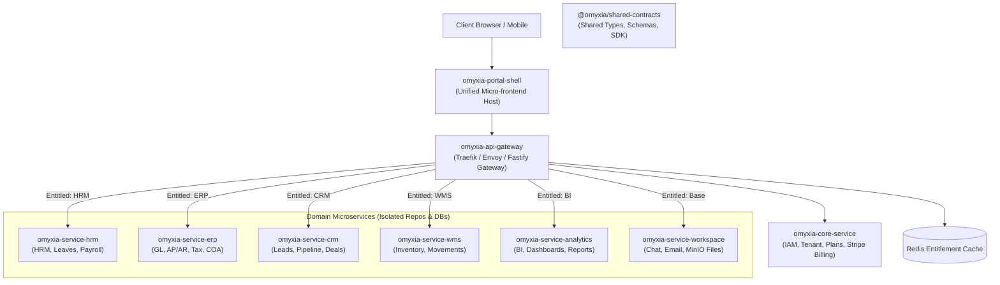

# 🏛️ Omyxia Microservices Architecture Blueprint

> **Status:** Approved Proposal / Phase 1 In Progress  
> **Target Version:** v3.0.0 Microservices Evolution  
> **Authors:** Omyxia Architecture & Engineering Management  

## 1. Executive Summary & Vision

To support enterprise scalability, independent team velocity, and flexible SaaS monetization, Omyxia is transitioning from an integrated Monolith / Monorepo blueprint to a **Multi-Repo Microservices Architecture with Dynamic Subscription-Based Entitlement**.

### Key Tenets
1. **Pay-as-you-grow Modular SaaS:** Microservices (HRM, ERP, CRM, WMS, BI, etc.) are dynamically entitled and exposed to customers based on their active subscription plan tier and purchased add-ons.
2. **Strict Perimeter Access Control:** An API Gateway acts as the single ingress point, enforcing Tenant Context, JWT validation, and real-time Feature/Service Entitlement verification before traffic touches any downstream microservice.
3. **Unified App Shell (Micro-frontend Portal):** A single Main Portal host application dynamically mounts micro-frontends according to the tenant's entitled services.
4. **Independent Repositories & Lifecycles:** Each bounded domain lives in its own Git repository with independent CI/CD pipelines, isolated databases, and deployment cadence.

---

## 2. Target Repository & Service Topology



### Repository Roster

| Repository | Responsibility | Storage | Stack |
|---|---|---|---|
| `omyxia-portal-shell` | App Shell, Global Nav, Tenant Switcher, Remote Micro-frontends Loader | Static / CDN | Next.js / Module Federation |
| `omyxia-api-gateway` | Reverse Proxy, Rate Limiting, JWT Validation, Entitlement Guard | Redis (Cache) | Fastify / Envoy / NestJS |
| `omyxia-core-service` | Tenant Lifecycle, User IAM, Plans & Add-on Entitlements, Stripe Billing | PostgreSQL (`omyxia_core`) | NestJS / Prisma |
| `omyxia-service-hrm` | Employee Directory, Attendance, Leaves, Payroll calculations | PostgreSQL (`omyxia_hrm`) | Node.js / Go / NestJS |
| `omyxia-service-erp` | Financial Ledgers, Invoicing, Tax Reports (WHT/VAT), Chart of Accounts | PostgreSQL (`omyxia_erp`) | NestJS / Prisma |
| `omyxia-service-crm` | Sales Pipelines, Customer Leads, Activities | PostgreSQL (`omyxia_crm`) | NestJS / Prisma |
| `omyxia-service-wms` | Warehousing, Stock Movements, SKU Tracking | PostgreSQL (`omyxia_wms`) | NestJS / Prisma |
| `omyxia-service-analytics`| KPI Aggregations, Data Exports, Scheduled Reports | ClickHouse / Postgres | Python / Node.js |
| `omyxia-service-workspace`| Realtime Socket.IO Chat, Stalwart Email Relay, S3/MinIO File Storage | MinIO + Redis + Postgres | NestJS / Go |
| `packages/shared-types` (→ `omyxia-shared-contracts`) | Zod Schemas, DTOs, Event Contracts, Service Access Enums | npm registry / git submodule | TypeScript |

---

## 3. Service Access Control & Dynamic Entitlement Guard

Traffic routing is governed by a **Two-Tier Security Check**:

### Flow
1. **User Request:** User invokes an endpoint, e.g. `POST /api/v1/erp/journals`.
2. **Gateway Ingress Authentication:**
   - Validates Bearer JWT (`sub`, `tenantId`, `role`).
   - Rejects unauthenticated traffic (HTTP 401).
3. **Entitlement Verification:**
   - Gateway fetches Tenant Entitlement state from Redis cache `tenant:{tenantId}:entitlements`.
   - If cache miss, queries `omyxia-core-service` (`GET /internal/v1/tenants/:id/entitlements`).
   - Checks if `targetService` (e.g. `erp`) is in `entitledServices` list or mapped to an active feature flag (`ERP_CORE`).
4. **Access Verdict:**
   - **Allowed:** Gateway injects trusted internal headers and proxies request to target microservice:
     - `X-Tenant-ID: <tenantId>`
     - `X-User-ID: <userId>`
     - `X-User-Role: <role>`
     - `X-Tenant-Plan: <plan>`
     - `X-Trace-ID: <uuid>`
   - **Forbidden:** If Tenant is on `STARTER` plan without ERP add-on:
     - Gateway immediately returns HTTP 403 Forbidden:
       ```json
       {
         "statusCode": 403,
         "error": "Forbidden",
         "message": "Tenant is not entitled to use the 'erp' microservice",
         "requiredFeature": "ERP_CORE",
         "upgradeUrl": "/admin/plans?highlight=erp"
       }
       ```

---

## 4. Main Portal (Micro-frontend App Shell)

The frontend architecture follows the **Host-Remote (Micro-frontend)** pattern:

1. **Host App Shell (`omyxia-portal-shell`):**
   - Renders Shell layout: Top navigation bar, Tenant Switcher, User Profile Menu, Notification Center.
   - Bootstraps by fetching `GET /api/v1/tenants/me/entitlements`.
   - Builds dynamic sidebar navigation displaying *only* entitled microservice apps.
2. **Dynamic Remote Mounting:**
   - Subscribed services are loaded as remote bundles (Webpack/Vite Module Federation or ES Modules).
   - If an un-entitled user navigates directly to `/erp/*`, the Shell renders a native **Upgrade Banner / Paywall Card** prompting the tenant admin to add the module.

---

## 5. Subscription Tiers & Microservice Entitlement Matrix

| Service Key | Microservice | Free Tier | Starter Plan | Pro Plan | Enterprise Plan | Standalone Add-on |
|---|---|:---:|:---:|:---:|:---:|:---:|
| `core` | IAM & Workspace Base | ✓ | ✓ | ✓ | ✓ | Included |
| `hrm` | HRM & Attendance | — | ✓ (up to 20 staff) | ✓ | ✓ | Available |
| `crm` | CRM & Pipeline | — | ✓ | ✓ | ✓ | Available |
| `erp` | Accounting & Tax | — | — | ✓ | ✓ | Available |
| `wms` | Warehouse & Inventory | — | — | — | ✓ | Available |
| `analytics` | BI & Custom Reports | Basic | Basic | Advanced | Custom | Available |

---

## 6. Phased Implementation Roadmap

### Phase 1: Shared Contracts & Entitlement Specifications (In Progress)
- [x] Standardize Service IDs and Access Enums (`packages/shared-types`).
- [x] Implement `ServiceAccessContext`, `ServiceEntitlementHeader`, and `evaluateServiceAccess` contract utilities.
- [x] Write comprehensive unit test coverage for access evaluation logic.

### Phase 2: Gateway & Core Entitlement Service
- [ ] Implement Gateway Middleware / Plugin for dynamic service verification.
- [ ] Connect Redis cache for low-latency (<5ms) entitlement lookups.
- [ ] Expose internal Entitlement Invalidation Webhook in `omyxia-core-service`.

### Phase 3: Pilot Microservice Extraction (HRM)
- [ ] Extract `apps/api/src/modules/hr` and `employees` into repository `open-uppu/omyxia-service-hrm`.
- [ ] Migrate HRM tables to separate database `omyxia_hrm`.
- [ ] Route `/api/v1/hrm/*` and `/api/v1/employees/*` through Gateway to new service.

### Phase 4: App Shell & Micro-frontend Federation
- [ ] Separate `apps/web` into `open-uppu/omyxia-portal-shell`.
- [ ] Implement dynamic navigation and module loader based on entitlement API.

### Phase 5: Full Decoupling (ERP, CRM, WMS, BI)
- [ ] Decouple ERP and CRM into respective repositories.
- [ ] Establish asynchronous event bus (RabbitMQ / Redis Pub-Sub) for cross-service events.
