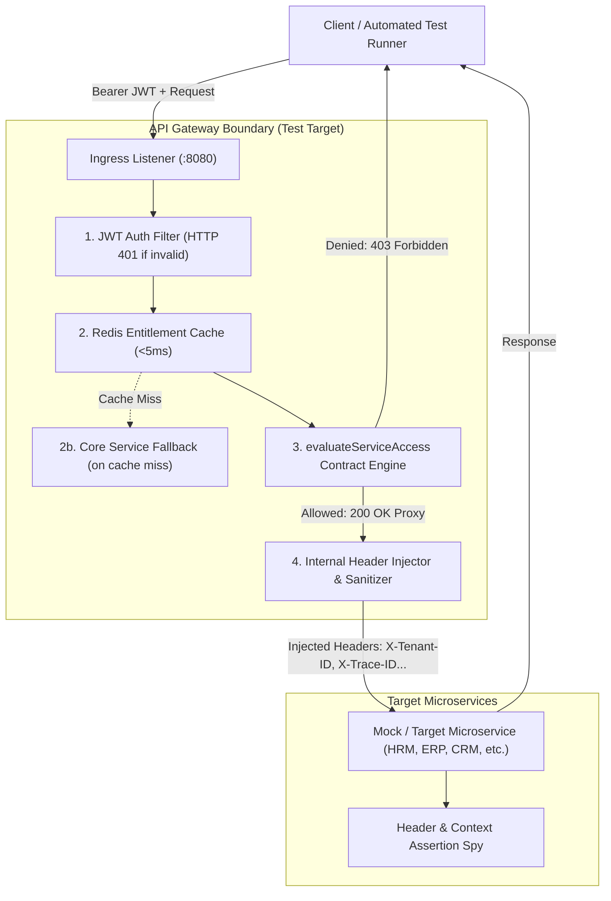
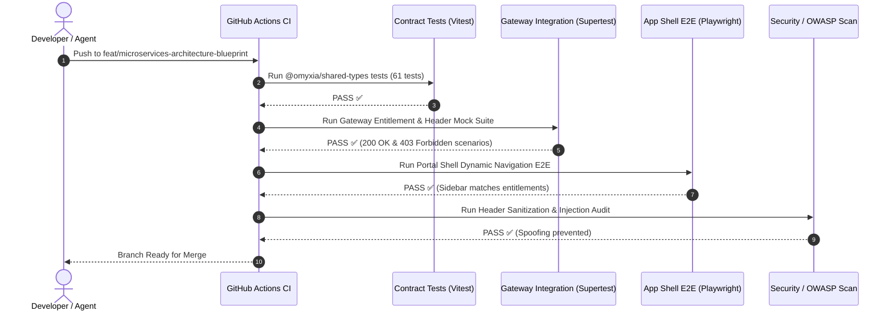

# 🧪 QA Test Plan: Microservices Entitlement & Gateway Access Control

> **Document Version:** 1.0.0  
> **Author:** Omyxia QA & Test Automation Lead 🧪  
> **Target Version:** v3.0.0 Microservices Evolution  
> **Architecture Reference:** [MICROSERVICES_BLUEPRINT.md](./MICROSERVICES_BLUEPRINT.md)  
> **Interface Contract:** `packages/shared-types/src/microservice-entitlements.ts`  
> **Active Branch:** `feat/microservices-architecture-blueprint`  
> **Status:** Approved / Phase 1 Verified (61 Automated Tests Passing)

---

## 1. Executive Summary & Test Objectives

As Omyxia transitions from an integrated monolith to a distributed multi-repo microservices architecture, perimeter security and tenant entitlement enforcement become mission-critical. This Test Plan establishes the quality assurance framework, test matrix, integration scenarios, and automated verification criteria for:

1. **Perimeter Entitlement Guard:** Ensuring API Gateway enforces subscription-based access control, returning `200 OK` (proxy to microservice) for entitled tenants and `403 Forbidden` (short-circuit with upgrade schema) for un-entitled tenants.
2. **Trusted Header Propagation & Distributed Tracing:** Verifying API Gateway reliably injects authenticated tenant context (`X-Tenant-ID`, `X-User-ID`, `X-User-Role`, `X-Tenant-Plan`, `X-Entitled-Services`) and distributed tracing (`X-Trace-ID`) to downstream microservices.
3. **Security Perimeter Hardening:** Proving client-injected internal headers are sanitized/stripped, and suspended tenants are rejected across all services.
4. **Cache & Performance SLA:** Validating Redis entitlement caching (`<5ms` latency target) and real-time cache invalidation upon plan upgrades/downgrades.

---

## 2. Architecture & Test Scope



### Components Under Test (CUT)
1. **Shared Contracts (`@omyxia/shared-types`):** Zod schemas (`ServiceAccessContextSchema`, `ServiceEntitlementHeaderSchema`, `MicroserviceIdSchema`, `ServicePlanTierSchema`) and pure function `evaluateServiceAccess`.
2. **API Gateway Middleware:** Ingress reverse-proxy filter intercepting all `/api/v1/:service/*` requests.
3. **Redis Entitlement Cache:** Key pattern `tenant:{tenantId}:entitlements` with TTL and invalidation webhook.
4. **Header Propagation Pipeline:** Sanitization of untrusted incoming headers and injection of trusted `x-*` headers.

---

## 3. Subscription Tiers & Entitlement Matrix

The following matrix must be verified across all automated test suites:

| Microservice ID | Route Prefix | Free Tier | Starter Plan | Growth Plan | Pro Plan | Enterprise Plan | Feature Flag Fallback |
|---|---|:---:|:---:|:---:|:---:|:---:|---|
| `core` | `/api/v1/core/*` | ✅ 200 OK | ✅ 200 OK | ✅ 200 OK | ✅ 200 OK | ✅ 200 OK | Always Allowed |
| `workspace` | `/api/v1/workspace/*` | ✅ 200 OK | ✅ 200 OK | ✅ 200 OK | ✅ 200 OK | ✅ 200 OK | `WORKSPACE_BASE` |
| `hrm` | `/api/v1/hrm/*` | ❌ 403 | ✅ 200 OK (≤20 staff) | ✅ 200 OK | ✅ 200 OK | ✅ 200 OK | `HRM_CORE`, `EMPLOYEE_MANAGEMENT` |
| `crm` | `/api/v1/crm/*` | ❌ 403 | ✅ 200 OK | ✅ 200 OK | ✅ 200 OK | ✅ 200 OK | `CRM_CORE`, `PIPELINE_MANAGEMENT` |
| `erp` | `/api/v1/erp/*` | ❌ 403 | ❌ 403 | ❌ 403 | ✅ 200 OK | ✅ 200 OK | `ERP_CORE`, `FINANCIAL_LEDGERS` |
| `wms` | `/api/v1/wms/*` | ❌ 403 | ❌ 403 | ❌ 403 | ❌ 403 | ✅ 200 OK | `WMS_CORE`, `INVENTORY_TRACKING` |
| `analytics` | `/api/v1/analytics/*`| Basic | Basic | Basic | ✅ 200 (Adv) | ✅ 200 (Custom) | `ANALYTICS_BI`, `ADVANCED_REPORTS` |
| `governance` | `/api/v1/governance/*`| ❌ 403 | ❌ 403 | ❌ 403 | ❌ 403 | ✅ 200 OK | `PDPA_COMPLIANCE`, `AUDIT_LOG_STREAMING` |

*Note: Any service marked with ❌ 403 can also be unlocked via explicit standalone add-on entitlement (`entitledServices.includes(serviceId)`).*

---

## 4. Integration & E2E Test Scenarios

### Scenario 1: Entitled Service Access (200 OK) with Header Propagation
* **Preconditions:** Tenant `tenant-acme-corp` is subscribed to `PRO` plan (`entitledServices: ['core', 'hrm', 'crm', 'erp']`).
* **Request:** `POST /api/v1/erp/journals` with `Authorization: Bearer <valid-jwt>`.
* **Execution Flow:**
  1. Gateway verifies JWT signature and extracts `tenantId: tenant-acme-corp`, `userId: usr-001`, `role: ADMIN`.
  2. Gateway checks Redis `tenant:tenant-acme-corp:entitlements` -> finds `erp` is entitled.
  3. Gateway generates `X-Trace-ID: uuid-v4-generated` (if client did not provide one).
  4. Gateway forwards request to downstream `omyxia-service-erp:3002/journals`.
* **Assertions:**
  - Downstream receives exact HTTP headers:
    - `x-tenant-id`: `tenant-acme-corp`
    - `x-user-id`: `usr-001`
    - `x-user-role`: `ADMIN`
    - `x-tenant-plan`: `PRO`
    - `x-entitled-services`: `core,hrm,crm,erp`
    - `x-trace-id`: valid UUIDv4 string.
  - Client receives HTTP `200 OK` (or `201 Created`).
  - Response header contains matching `X-Trace-ID`.

### Scenario 2: Un-entitled Service Access (403 Forbidden) & Upgrade Envelope
* **Preconditions:** Tenant `tenant-cafe-shop` is on `STARTER` plan (entitled to `core`, `hrm`, `crm`; NOT entitled to `erp`).
* **Request:** `GET /api/v1/erp/reports/balance-sheet` with `Authorization: Bearer <valid-jwt>`.
* **Execution Flow:**
  1. Gateway verifies JWT and checks Redis entitlement cache for `tenant-cafe-shop`.
  2. Entitlement engine evaluates `targetService = 'erp'` -> Result: `allowed: false`.
  3. Gateway short-circuits request **without invoking downstream ERP service**.
* **Assertions:**
  - Client receives HTTP `403 Forbidden`.
  - Downstream ERP service log receives `0` incoming requests.
  - Response body conforms to contract schema:
    ```json
    {
      "statusCode": 403,
      "error": "Forbidden",
      "message": "Tenant is not entitled to use the 'erp' microservice",
      "requiredFeature": "ERP_CORE",
      "upgradeUrl": "/admin/plans?highlight=erp"
    }
    ```

### Scenario 3: Header Spoofing & Tampering Prevention
* **Preconditions:** Tenant `tenant-attacker` on `FREE` plan attempts privilege escalation.
* **Request:** `GET /api/v1/hrm/employees` with:
  - Header: `Authorization: Bearer <valid-free-tenant-jwt>`
  - Malicious Header: `X-Tenant-ID: tenant-victim-enterprise`
  - Malicious Header: `X-User-Role: OWNER`
  - Malicious Header: `X-Tenant-Plan: ENTERPRISE`
* **Execution Flow:**
  1. Gateway receives request and strips all incoming untrusted `X-Tenant-*`, `X-User-*` headers.
  2. Gateway extracts genuine tenant context from verified JWT.
* **Assertions:**
  - Gateway rejects or overrides client headers with genuine claims.
  - If unentitled, returns HTTP 403.
  - Even if route is accessible, downstream receives strictly the claims from JWT (`tenant-attacker`), completely ignoring spoofed headers.

### Scenario 4: Suspended Tenant Global Lockout
* **Preconditions:** Tenant `tenant-overdue` has `isSuspended: true` due to unpaid Stripe invoice.
* **Request:** `GET /api/v1/core/profile` and `GET /api/v1/hrm/attendance`.
* **Assertions:**
  - Both requests return HTTP `403 Forbidden`.
  - Response body:
    ```json
    {
      "statusCode": 403,
      "error": "Forbidden",
      "message": "Tenant is currently suspended",
      "reason": "TENANT_SUSPENDED",
      "upgradeUrl": "/billing/reactivate"
    }
    ```

### Scenario 5: Real-Time Cache Invalidation on Subscription Upgrade
* **Preconditions:** Tenant upgrades from `STARTER` to `PRO` via Stripe Checkout.
* **Execution Flow:**
  1. Initial request to `/api/v1/erp/coa` returns `403 Forbidden` (cached in Redis).
  2. Core Service processes Stripe webhook `invoice.payment_succeeded` -> updates database.
  3. Core Service publishes Redis pub/sub eviction or deletes key `tenant:{tenantId}:entitlements`.
  4. Immediate subsequent request to `/api/v1/erp/coa` is made within `<200ms`.
* **Assertions:**
  - Gateway misses cache, queries Core Service, refreshes Redis cache.
  - Request immediately succeeds with HTTP `200 OK`.
  - Zero stale `403 Forbidden` responses observed after webhook acknowledgement.

---

## 5. Comprehensive Test Cases Catalog

| Test Case ID | Category | Title & Purpose | Inputs / Conditions | Expected Result | Priority |
|---|---|---|---|---|---|
| **TC-ENT-001** | Unit/Contract | Validate all valid `MicroserviceId` enum values | `core, hrm, erp, crm, wms, workspace, analytics, governance` | Schema parses successfully | P0 (Critical) |
| **TC-ENT-002** | Unit/Contract | Reject unregistered microservice ID | `invalid_service_id` | Zod validation error thrown | P1 (High) |
| **TC-ENT-003** | Unit/Contract | Validate `ServicePlanTier` enum values | `FREE, STARTER, GROWTH, PRO, ENTERPRISE` | All valid tiers parsed, invalid rejected | P0 (Critical) |
| **TC-ENT-004** | Unit/Contract | Core service always permitted for active tenant | Active tenant, empty entitledServices | `allowed: true, serviceId: 'core'` | P0 (Critical) |
| **TC-ENT-005** | Unit/Contract | Explicit service entitlement grant | `entitledServices: ['hrm', 'erp']`, target: `erp` | `allowed: true, serviceId: 'erp'` | P0 (Critical) |
| **TC-ENT-006** | Unit/Contract | Feature-flag fallback entitlement grant | `enabledFeatures: ['ERP_CORE']`, target: `erp` | `allowed: true, serviceId: 'erp'` | P0 (Critical) |
| **TC-ENT-007** | Unit/Contract | Secondary feature-flag fallback grant | `enabledFeatures: ['FINANCIAL_LEDGERS']`, target: `erp` | `allowed: true, serviceId: 'erp'` | P1 (High) |
| **TC-ENT-008** | Unit/Contract | Denial when un-entitled with upgrade URL | Tenant on STARTER, target: `wms` | `allowed: false, reason: 'SERVICE_NOT_ENTITLED', upgradeUrl: ...` | P0 (Critical) |
| **TC-ENT-009** | Unit/Contract | Suspended tenant blocks all services | `isSuspended: true`, target: `core`, `hrm`, `erp` | `allowed: false, reason: 'TENANT_SUSPENDED'` | P0 (Critical) |
| **TC-ENT-010** | Contract | Gateway header schema validation (with trace-id) | Valid `x-tenant-id`, `x-trace-id`, etc. | Schema parses successfully | P0 (Critical) |
| **TC-ENT-011** | Contract | Gateway header schema validation (without trace-id) | Valid headers, optional trace-id omitted | Schema parses with undefined trace-id | P1 (High) |
| **TC-ENT-012** | Contract | Reject empty `x-tenant-id` header | `x-tenant-id: ""` | Zod validation error thrown | P0 (Critical) |
| **TC-ENT-013** | Integration | Ingress unauthenticated request rejection | Missing or malformed `Authorization` header | HTTP `401 Unauthorized` | P0 (Critical) |
| **TC-ENT-014** | Integration | Entitled proxy routing | Valid JWT, entitled `hrm` route | HTTP `200 OK` via downstream proxy | P0 (Critical) |
| **TC-ENT-015** | Integration | Unentitled route short-circuit | Valid JWT, unentitled `wms` route | HTTP `403 Forbidden`, downstream untouched | P0 (Critical) |
| **TC-ENT-016** | Integration | Downstream header injection assertion | Valid request to `/api/v1/crm/*` | Downstream receives all 6 `x-*` headers | P0 (Critical) |
| **TC-ENT-017** | Security | Client header spoofing sanitization | Client sends spoofed `X-Tenant-ID` | Gateway overrides with token claims | P0 (Critical) |
| **TC-ENT-018** | Security | Trace ID generation when absent | Request without `X-Trace-ID` | Gateway generates UUIDv4 trace ID | P1 (High) |
| **TC-ENT-019** | Security | Trace ID preservation when supplied | Request with valid `X-Trace-ID` | Gateway preserves and propagates existing ID | P1 (High) |
| **TC-ENT-020** | Performance | Redis entitlement cache hit latency | Repeated requests for same tenant | Latency `< 5ms` on cache hit | P1 (High) |
| **TC-ENT-021** | Resilience | Redis cache miss fallback to Core Service | Cold tenant not in Redis cache | Gateway queries Core Service & populates Redis | P1 (High) |
| **TC-ENT-022** | Resilience | Real-time cache invalidation on upgrade | Plan upgrade webhook triggered | Subsequent request immediately reflects new plan | P0 (Critical) |
| **TC-ENT-023** | E2E | App Shell UI dynamic navigation verification | Tenant with `['hrm', 'crm']` | Sidebar renders HRM & CRM, hides ERP & WMS | P1 (High) |
| **TC-ENT-024** | E2E | App Shell UI direct navigation to unentitled URL | Direct URL hit to `/erp/journals` | UI displays Paywall / Upgrade Banner component | P1 (High) |
| **TC-ENT-025** | E2E | Token expiry during active session | JWT expires while browsing | HTTP 401 triggers silent refresh or re-login | P0 (Critical) |

---

## 6. Automated Test Harness & Execution Evidence

### 6.1 Unit & Contract Test Execution
The contract tests in `@omyxia/shared-types` verify the formal interfaces and decision engine logic:

* **Test Suite:** `packages/shared-types/src/microservice-entitlements.test.ts`
* **Command:** `pnpm -C /Users/up-mac/wokrspace/open-uppu/omyxia --filter @omyxia/shared-types test`
* **Results:**
  ```text
  RUN  v2.1.9 /Users/up-mac/wokrspace/open-uppu/omyxia/packages/shared-types

  ✓ src/admin-impersonate.test.ts (17)
  ✓ src/admin-tenants.test.ts (28)
  ✓ src/microservice-entitlements.test.ts (13)
  ✓ src/index.test.ts (3)

  Test Files  4 passed (4)
       Tests  61 passed (61)
    Duration  245ms
  ```
* **Status:** Passed 61/61 tests without failure.

### 6.2 Recommended CI/CD Quality Gate Pipeline



---

## 7. QA Sign-off & Next Steps

1. **Phase 1 Contracts:** **PASSED & SIGNED-OFF** (Contracts, Enums, Zod Schemas, and `evaluateServiceAccess` unit test coverage complete).
2. **Phase 2 Handoff (Backend & DevOps):**
   - Implement Gateway Fastify/NestJS plugin referencing `@omyxia/shared-types`.
   - Setup Redis container in docker-compose for local integration testing.
3. **Phase 3 Handoff (Frontend):**
   - Integrate `evaluateServiceAccess` in `omyxia-portal-shell` navigation guard.
