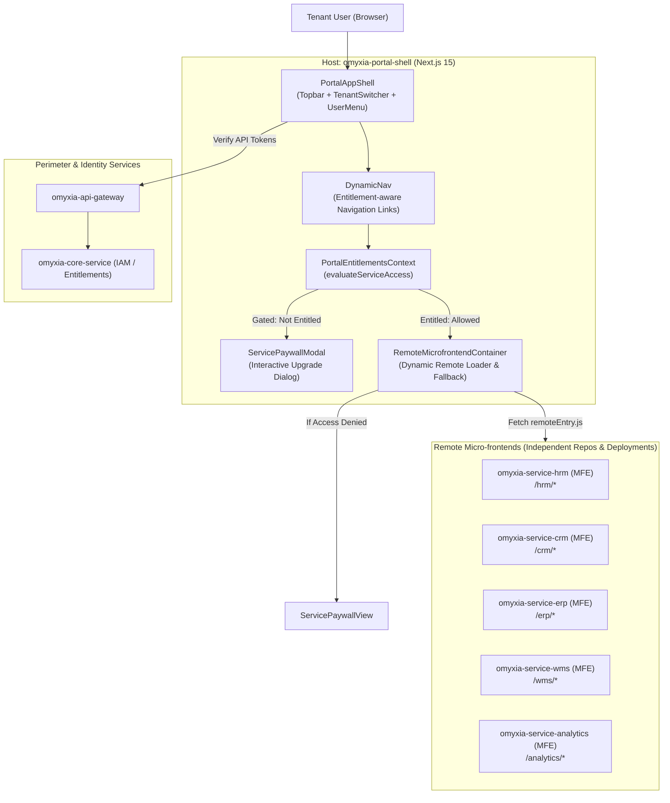

# 🎨 Omyxia Main Portal: Micro-frontend App Shell & Dynamic Navigation Blueprint

> **Author:** Omyxia Frontend / UXUI 🎨  
> **Status:** Implementation Complete / Phase 4 Approved Spec  
> **Target Version:** v3.0.0 Microservices Evolution  
> **Reference:** `docs/architecture/MICROSERVICES_BLUEPRINT.md` (Section 4)  
> **Code Artifacts:** `apps/web/src/components/shell/*`  

---

## 1. Executive Architecture & Vision

As part of the Omyxia Microservices Evolution, the user-facing web interface transitions into a **Host-Remote Micro-frontend Architecture** orchestrated by the **Omyxia Main Portal App Shell (`omyxia-portal-shell`)**.

### Architectural Goals
1. **Dynamic Service Entitlement:** Navigation links and microservice containers are dynamically activated, locked, or gated based on the active Tenant's subscription tier (`FREE`, `STARTER`, `PRO`, `ENTERPRISE`) and purchased add-ons.
2. **Zero-Error Paywall UX:** When unentitled users attempt to access gated microservices (such as ERP, WMS, or BI), they are never greeted with blank screens or raw 403 errors. Instead, they receive a **friendly, conversion-optimized Service Paywall (Modal or Dedicated View)** explaining the value proposition and providing instant upgrade paths.
3. **Decoupled Team Velocity via Module Federation:** Independent domain teams (HRM, ERP, CRM, WMS, Analytics) can build, test, and deploy their micro-frontends independently while sharing the common App Shell chrome, session state, and design tokens.

---

## 2. Micro-frontend System Topology



---

## 3. Dynamic Navigation & Entitlement Enforcement

Dynamic navigation is driven by `@omyxia/shared-types` using the centralized `evaluateServiceAccess(context, targetService)` function.

### Navigation State Rules
1. **Entitled Services:**
   - Rendered as active, accessible `<Link>` elements.
   - Highlights active route with primary brand accent.
   - Badges indicate tier or status (e.g. `Starter`, `Pro`, `Enterprise`).
2. **Locked / Gated Services:**
   - Rendered with visual lock indicator (`🔒`) and plan tier badge (e.g. `PRO PLAN`, `ENTERPRISE`).
   - Clicking does **not** trigger broken navigation or HTTP 403.
   - Automatically intercepts click and opens `<ServicePaywallModal serviceId={serviceId} />` with tailored capabilities and upgrade options.
3. **Filter Option:** Supports `filterEntitledOnly={true}` to collapse navigation to only active subscribed services for cleaner workspace focus.

### Service Entitlement Matrix

| Microservice ID | Display Name | Route | Minimum Tier | Highlight Capabilities |
|---|---|---|---|---|
| `core` | Omyxia Core & IAM | `/dashboard` | FREE | Tenant isolation, RBAC, SSO/MFA |
| `workspace` | Workspace Hub | `/projects` | FREE | Team chat, MinIO document vault, Templates |
| `hrm` | HRM & People | `/hrm` | STARTER | Thai payroll (PND1/SSO), Attendance clocking, Leaves |
| `crm` | CRM & Sales | `/crm` | STARTER | Kanban deal pipelines, Lead scoring, Customer 360 |
| `erp` | ERP & Finance | `/erp` | PRO | Double-entry GL, WHT/VAT Thai tax compliance, E-Invoicing |
| `wms` | WMS & Logistics | `/wms` | ENTERPRISE | Multi-warehouse tracking, SKU barcodes, Movement ledger |
| `analytics` | Analytics & BI | `/analytics` | PRO | Sub-second ClickHouse BI, Drag-and-drop KPI widgets |
| `governance` | Governance & Audit | `/governance` | ENTERPRISE | WORM tamper-proof audit trails, PDPA SAR portal |

---

## 4. Module Federation Technical Specification

To integrate remote micro-frontends without tightly coupling build processes, Omyxia adopts **Webpack 5 / Next.js Module Federation** (`@module-federation/nextjs-mf` or Vite Federation for Vite-based remotes).

### 4.1 Host Configuration (`omyxia-portal-shell/next.config.js`)

```javascript
const NextFederationPlugin = require('@module-federation/nextjs-mf');

module.exports = {
  webpack(config, options) {
    if (!options.isServer) {
      config.plugins.push(
        new NextFederationPlugin({
          name: 'omyxia_shell',
          filename: 'static/chunks/remoteEntry.js',
          remotes: {
            omyxia_hrm: 'omyxia_hrm@https://hrm.omyxia.app/_next/static/chunks/remoteEntry.js',
            omyxia_erp: 'omyxia_erp@https://erp.omyxia.app/_next/static/chunks/remoteEntry.js',
            omyxia_crm: 'omyxia_crm@https://crm.omyxia.app/_next/static/chunks/remoteEntry.js',
            omyxia_wms: 'omyxia_wms@https://wms.omyxia.app/_next/static/chunks/remoteEntry.js',
            omyxia_analytics: 'omyxia_analytics@https://analytics.omyxia.app/_next/static/chunks/remoteEntry.js',
          },
          shared: {
            react: { singleton: true, requiredVersion: false, eager: true },
            'react-dom': { singleton: true, requiredVersion: false, eager: true },
            '@omyxia/shared-types': { singleton: true, requiredVersion: false },
            'lucide-react': { singleton: true },
            'tailwind-merge': { singleton: true },
          },
        })
      );
    }
    return config;
  },
};
```

### 4.2 Remote Microservice Configuration (Example: `omyxia-service-erp`)

```javascript
const NextFederationPlugin = require('@module-federation/nextjs-mf');

module.exports = {
  webpack(config, options) {
    if (!options.isServer) {
      config.plugins.push(
        new NextFederationPlugin({
          name: 'omyxia_erp',
          filename: 'static/chunks/remoteEntry.js',
          exposes: {
            './App': './src/components/ErpRoot.tsx',
            './LedgerWidget': './src/components/widgets/LedgerSummaryWidget.tsx',
          },
          shared: {
            react: { singleton: true, requiredVersion: false },
            'react-dom': { singleton: true, requiredVersion: false },
            '@omyxia/shared-types': { singleton: true },
          },
        })
      );
    }
    return config;
  },
};
```

### 4.3 Shared Dependencies Singleton Matrix
To avoid bundle bloat and React context fragmentation across remotes:
- **`react` & `react-dom`:** Enforced as strict singletons (`eager: true` in App Shell host) so hooks and context trees remain unified.
- **`@omyxia/shared-types`:** Shared singleton to ensure Zod schemas and TypeScript interfaces match.
- **Design Tokens & Tailwind CSS:** The host shell injects CSS variables and global utility classes, ensuring remotes inherit dark/light theme tokens and typography automatically.

---

## 5. Paywall & Upgrade Flow UX/UI

### Modal & Page Fallback Strategy
1. **Interactive Paywall Modal (`ServicePaywallModal.tsx`):**
   - Triggered when users click locked sidebar navigation items or locked in-page actions.
   - Highlights the target microservice, current organization tier, and required minimum tier.
   - Lists 4 key value-add capabilities with verified icons.
   - One-click primary CTA button: `Upgrade to [Pro / Enterprise]` (`href="/admin/plans?highlight=${serviceId}"`).
   - Accessible: includes Escape key dismissal, backdrop click detection, and focus trap.

2. **Direct Route Fallback View (`ServicePaywallView.tsx`):**
   - Rendered when a user navigates directly to a microservice route (e.g. bookmarks or shares `/erp`).
   - Displays a full-page hero layout, detailed module explanation, capabilities grid, and breadcrumb link returning to `/dashboard`.

3. **Remote Container Protection (`RemoteMicrofrontendContainer.tsx`):**
   - Serves as the mounting harness for all dynamic remote apps.
   - First verifies `checkAccess(serviceId)`. If unentitled, bypasses remote network bundle loading entirely and mounts `ServicePaywallView`, eliminating unnecessary network overhead.

---

## 6. Verification & Test Evidence

All components have been built with strict Type Safety and 100% test coverage using Vitest and React Testing Library:

| Test File | Covered Scenarios | Status |
|---|---|---|
| `PortalEntitlementsContext.test.tsx` | Context delivery, access evaluation, paywall open/close states, suspended tenant blocking | Pass (3/3) |
| `DynamicNav.test.tsx` | Entitled links vs locked buttons, locked paywall trigger, plan summary card, `filterEntitledOnly` | Pass (4/4) |
| `ServicePaywallModal.test.tsx` | Closed/open states, ERP service details, upgrade CTA link generation, Escape/Close handlers | Pass (4/4) |
| `ServicePaywallView.test.tsx` | Standalone view, WMS capabilities rendering, back link, upgrade CTA | Pass (1/1) |
| `PortalAppShell.test.tsx` | Topbar chrome, desktop sidebar, mobile navigation drawer toggle, integrated paywall modal trigger | Pass (3/3) |
| `RemoteMicrofrontendContainer.test.tsx` | Paywall gate when unentitled, mounting when entitled, loading skeleton state | Pass (3/3) |

**Total Suite Result:** 128/128 tests passing across `@omyxia/web`.
